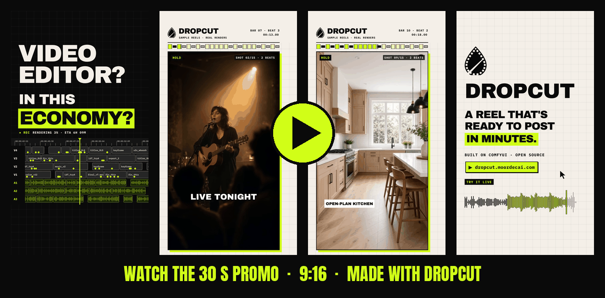
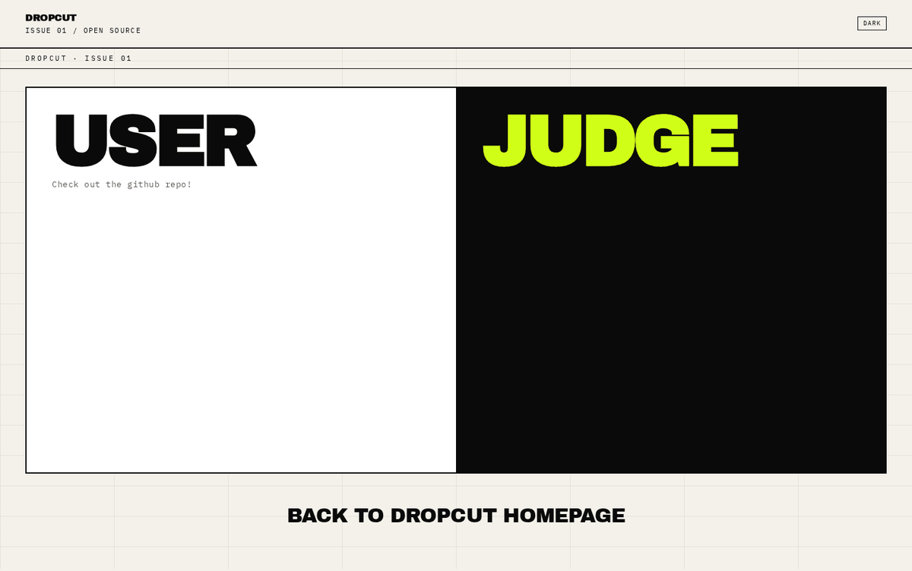
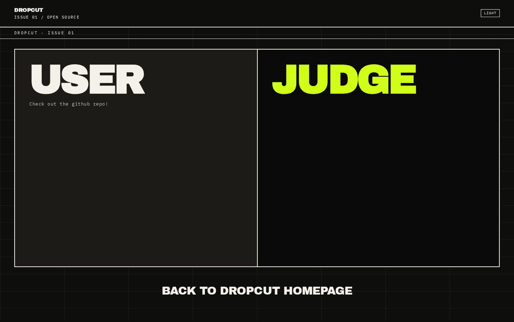
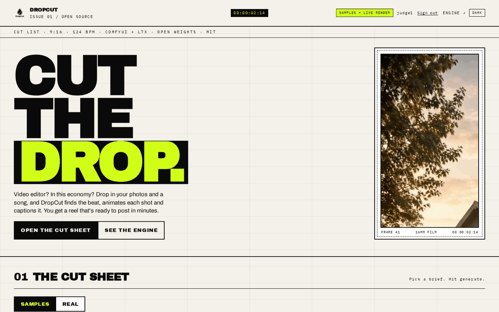
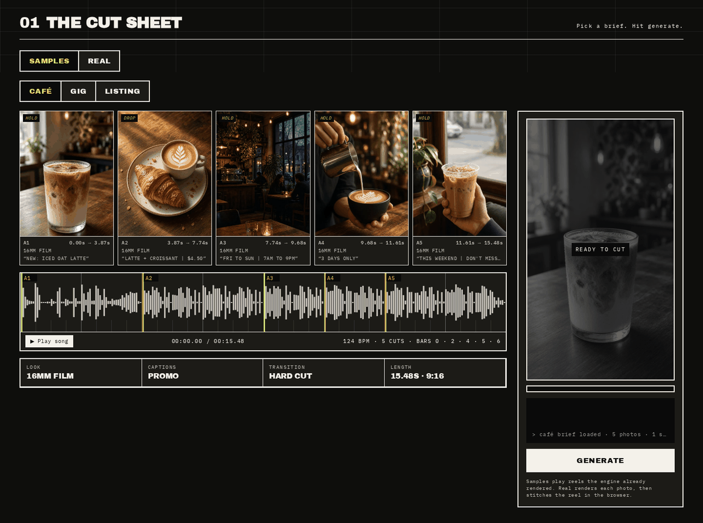
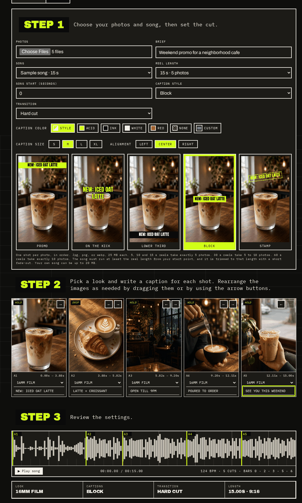
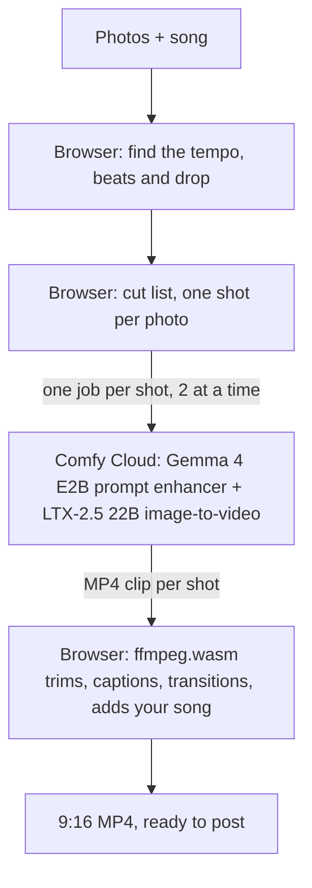

# DropCut

**Video editor? In this economy? Drop in your photos and a song, and DropCut finds the beat, animates each shot and captions it. You get a reel that's ready to post in minutes.**

An open-source rebuild of Higgsfield's Urban Cuts, built on ComfyUI and LTX-2.5. Any photos, 5 to 60 second reels, up to 10 photos, every photo animated and captioned on its own, every cut on the beat.

**[Try it live](https://dropcut-judges.moordecai.com/)** · **[Product page](https://dropcut.moordecai.com/)** · **[Engine repo](https://github.com/venthewise/dropcut)** · MIT

[](docs/dropcut-promo.mp4)

<sub>Click to watch the 30 s promo. It's a vertical 9:16 reel, made in the same style as what DropCut exports.</sub>

| Landing (light) | Landing (dark) |
| --- | --- |
|  |  |

---

## Contents

- [Why DropCut](#why-dropcut)
- [Requirements](#requirements)
- [App guide](#app-guide)
- [How to run DropCut yourself (Comfy Cloud)](#how-to-run-dropcut-yourself-comfy-cloud)
- [Features](#features)
- [Models](#models)
- [How it works](#how-it-works)
- [Run locally (Coming soon)](#run-locally-coming-soon)
- [Deploy your own (Vercel)](#deploy-your-own-vercel)
- [Tests](#tests)
- [Limits](#limits)
- [Project structure](#project-structure)
- [Credits and license](#credits-and-license)

## Why DropCut

Urban Cuts turns a handful of shots into a reel cut to music. DropCut rebuilds that idea in the open and stretches it:

- **Open source, end to end.** The app, the ComfyUI workflow and the beat detection are all in this repo under MIT.
- **Any photos.** Cafés, gigs, listings, products, your dog. Each photo gets its own look and its own caption.
- **5 to 60 second reels**, from 5 photos up to 10.
- **It actually listens.** DropCut finds the tempo and the loudest hit of your song and puts the cuts on the beat, with one cut landing on the drop.
- **Your song stays yours.** The music never leaves your browser. The reel is stitched there with ffmpeg.wasm.

## Requirements

| You need | Why |
| --- | --- |
| A [Comfy Cloud](https://cloud.comfy.org/) account on a **paid plan** | The free plan can't be used by apps. Every shot renders on your own deployment and is paid from your credits. |
| A Comfy deployment of `workflows/ltx-i2v.api.json` | This is the LTX-2.5 image-to-video workflow DropCut calls. Part 1 of the guide below shows how. |
| [Node.js](https://nodejs.org/) 22 | Runs the small local server (`package.json` pins Node 22.x). |
| A recent desktop browser | The beat detection and the final stitch run in the browser. |
| 5 to 10 photos (jpg, png or webp, up to 25 MB each) and a song (up to 20 MB), or one of the built-in sample songs | The raw material. |

**Just browsing?** You need none of this. Open the [live site](https://dropcut-judges.moordecai.com/) and press **USER** for this repo, or run it yourself and use **Samples**.

## App guide

The live site opens on two doors: **USER** takes you to this repo, **JUDGE** takes you to the login. There's a light/dark toggle in the top right, and it remembers your choice.



After you sign in you land on the **Cut Sheet**, with two tabs:

- **Samples** play three finished reels (café, gig and listing) with their cut list, waveform, beats and captions. Nothing renders, so it's free and instant.
- **Real** makes a new reel from your photos in four steps: pick photos, song and settings; set a look and caption per shot; check the cut on the waveform; press **Generate**.

**Samples:** cut times per shot, beat-aligned cuts on the waveform, 124 BPM.



**Real:** your photos, song, caption style and transition, then a look and caption for each shot.

<p align="center"></p>

## How to run DropCut yourself (Comfy Cloud)

### Part 1: Set up Comfy Cloud (one time)

1. Sign up at [Comfy Cloud](https://cloud.comfy.org/) on a paid plan. The free plan can't be used by apps.
2. Create an API key in your Comfy account and keep it private.
3. Download [dropcut-judges](https://github.com/venthewise/dropcut-judges) (green **Code** button, then **Download ZIP**) and unzip it.
4. In [Comfy Cloud](https://platform.comfy.org/), log in and create a new deployment from the file `workflows/ltx-i2v.api.json` in that folder. That's DropCut's LTX-2.5 image-to-video workflow.
5. Copy the deployment's endpoint URL once it's running. If you haven't created an API key yet, create one on the same page after the deployment succeeds.

### Part 2: Run DropCut on your computer

1. Install [Node.js](https://nodejs.org/).
2. In the DropCut folder, make a copy of `.env.example` and rename it `.env`.
3. Open `.env` and paste in your API key next to `COMFY_CLOUD_API_KEY` and your endpoint URL next to `COMFY_DEPLOYMENT_ENDPOINT`. For `SESSION_SECRET`, replace the placeholder with any long random string.
4. Open a terminal in the folder and run `node scripts/add-judge.mjs judge1` to make your login. The password is saved in `judges-credentials.txt` and isn't shown on screen.
5. Run `npm start` and open [http://127.0.0.1:5180](http://127.0.0.1:5180/).
6. Sign in with `judge1` and the password from that file.

### Part 3: Make a reel

1. Choose **Real**, then add your photos (5 to 10, depending on the length).
2. Pick a reel length (5, 10, 15, 30 or 60 s) and a sample song or your own.
3. Set the caption style and press **Generate**. Each photo is animated on your Comfy deployment and paid from your credits, and the final reel is put together in your browser.

**Just looking?** Skip Part 1 and choose **Samples** to watch the café, gig and listing examples without generating anything.

## Features

| Feature | What it does |
| --- | --- |
| **Beat finding** | Reads the song's tempo and beats, then snaps each cut to the nearest beat. The loudest moment (the drop) gets a cut of its own. Each shot runs 0.35 to 6.5 s. |
| **Per-photo animation** | Each photo becomes its own moving shot through LTX-2.5 image-to-video, with the photo as the first frame. |
| **Looks** | Pick one per shot: 16mm Film, Acid Neon, Ink, Glitch, Xerox or Chrome. Each look is a tuned prompt plus a negative prompt. |
| **Brief** | One line about what the reel is for and how it should feel. It's added to every shot's prompt. |
| **Captions** | One caption per photo (up to 72 characters), burned into the video. Five styles: Block, Stamp, Lower third, On the kick and Promo, plus color, size (S to XL) and alignment, with a live preview. |
| **Transitions** | Hard cut, Flash or Whip. |
| **Reel lengths** | 5, 10 or 15 s with 5 photos, 30 s with 5 to 10, and 60 s with 10. |
| **Song control** | Sample songs (15, 30 and 60 s) or your own audio, with a start point so the reel uses the best part. The audio fades out over the last 0.5 s. |
| **Reorder shots** | Drag the cards or use the arrow buttons. |
| **Cancel and resume** | Once every shot has rendered, cancelling or a failed stitch keeps the clips, and **Generate** reuses them instead of paying for them twice. |
| **Export** | A 1080 × 1920, 24 fps H.264 MP4 with AAC audio, ready for Reels, TikTok and Shorts. |
| **Light and dark mode** | Follows your system at first, then remembers your pick on every page. |
| **Judge login** | Named accounts with scrypt-hashed passwords and signed 8-hour session cookies, so the live demo's credits stay safe. |

## Models

Every model file the workflow loads (`workflows/ltx-i2v.api.json`):

| Role | Loader node | File |
| --- | --- | --- |
| Video model: LTX-2.5 22B distilled, image-to-video with audio | `UNETLoader` | `ltx-2.5-22b-distilled-transformer-comfy-int8-convrot.safetensors` |
| Text encoder for LTX-2.5 (Gemma 4 12B) | `CLIPLoader` (type `ltxv`) | `gemma4-12b-with-proj-ltx-2.5-comfy-int8-convrot.safetensors` |
| Prompt enhancer: looks at the photo and rewrites the shot prompt (Gemma 4 E2B) | `CLIPLoader` (type `ltxv`), used by `TextGenerateLTX2Prompt` | `gemma4_e2b_it_int8_convrot.safetensors` |
| Video VAE | `VAELoader` | `ltx-2.5-video-vae-bf16.safetensors` |
| Audio VAE | `VAELoader` | `ltx-2.5-audio-vae-bf16.safetensors` |
| 2× latent spatial upscaler | `LatentUpscaleModelLoader` | `ltx-2.5-latent-spatial-upscaler-x2-bf16-1.0.safetensors` |

No LoRAs. The prompt enhancer is switched on by the app for every shot.

What runs in the browser is not a model:

- **Beat detection** (`lib/cuts.mjs`) is our own signal-processing code, with no ML. It finds onsets as spectral flux over 24 frequency bands (kicks and bass count extra), estimates the tempo by autocorrelation, then checks double, half and ¾ alternatives against the onsets so a 124 BPM track isn't read as 165. It fits the beat grid to the kicks to within a few milliseconds and takes the loudest 0.35 s as the drop.
- **[ffmpeg.wasm](https://github.com/ffmpegwasm/ffmpeg.wasm)** trims, frames and stitches the clips, overlays the captions, adds the transitions and lays your song underneath.
- **[Anton](https://fonts.google.com/specimen/Anton)** (SIL Open Font License) draws the captions.

## How it works



1. **Listen.** The browser decodes your song, takes the window you picked, and finds the tempo, the beats and the drop.
2. **Cut.** `buildCutList` gives each photo a slot, snaps every cut to the nearest beat (one lands on the drop) and gives each shot its own seed.
3. **Render.** For each shot the server uploads the photo to your deployment (`/api/v2/assets`), patches the workflow and submits it (`/api/v2/jobs`). The shot length is rounded up to whole seconds (1 to 10). The browser polls every 2 s and runs two shots at once.
4. **Inside the workflow.** The photo is resized and preprocessed, the Gemma 4 E2B enhancer writes a richer prompt from the photo and the brief, and LTX-2.5 makes a first pass at half resolution, upscales it 2× in latent space and refines it, then decodes at 24 fps.
5. **Stitch.** ffmpeg.wasm trims each clip to its exact beat-aligned length (holding the last frame if a render runs short), scales it to 1080 × 1920, burns in the caption, adds the transition and lays your song underneath. The audio LTX generates is dropped, so you only hear your song.

### ComfyUI nodes the app writes to

`workflows/ltx-i2v.map.json` tells the server which inputs to fill:

| Node | Input | DropCut sets |
| --- | --- | --- |
| `395` LoadImage | `image` | The uploaded photo |
| `398:376` Prompt | `value` | Look prompt + brief |
| `398:373` Negative prompt | `text` | The look's negative prompt |
| `398:339`, `398:338` RandomNoise | `noise_seed` | The shot's seed |
| `398:362` Duration | `value` | Shot length in whole seconds (frames = duration × fps + 1, computed in the graph) |
| `398:361` Frame Rate | `value` | 24 |
| `403` Resolution Selector | `aspect_ratio` | `9:16 (Portrait Widescreen)` (the saved file says 16:9; the app always overrides it) |
| `398:383` Enable Prompt Enhance | `value` | `true` |
| `75` SaveVideo | output | The clip the app downloads |

The workflow runs on Comfy Cloud as-is.

## Run locally (Coming soon)

Running DropCut against ComfyUI on your own GPU isn't supported yet. The app only talks to a Comfy Cloud deployment for now. A local mode is on the roadmap. Until then, use the Comfy Cloud guide above. The app itself already runs on your computer; only the rendering happens in the cloud.

## Deploy your own (Vercel)

<details>
<summary>Host your own copy on Vercel</summary>

Import the repo in Vercel:

- Framework Preset: **Other**
- Root Directory: `./` (repo root)
- Build Command: leave empty (no build). Output Directory: leave empty (repo root is served as static files)
- Install Command: `npm install` (only installs `@vercel/functions` for the middleware)

`middleware.js` gates every request with the session cookie. `/login` and `/logout` are rewritten to `api/login.mjs` and `api/logout.mjs`; `/` is served by `api/page.mjs` with the judge name filled in. App files and `/media` return 401 when signed out; `/vendor` (ffmpeg.wasm and the Anton font) is public static.

**Environment variables**

| Name | Value |
| --- | --- |
| `COMFY_CLOUD_API_KEY` | Comfy Cloud API key |
| `COMFY_DEPLOYMENT_ENDPOINT` | Comfy deployment endpoint URL |
| `SESSION_SECRET` | 32+ random characters: `node -e "console.log(require('crypto').randomBytes(32).toString('hex'))"` |
| `JUDGE_ACCOUNTS` | Output of `node scripts/add-judge.mjs --env` (JSON of scrypt hashes, no passwords) |

See `.env.example`. Changing `SESSION_SECRET` signs everyone out.

**Add a login**

```bash
node scripts/add-judge.mjs judge2      # password goes to judges-credentials.txt
node scripts/add-judge.mjs --env       # prints the new JUDGE_ACCOUNTS value
```

Paste the printed value into `JUDGE_ACCOUNTS` in Vercel and redeploy.

</details>

## Tests

```bash
npm install
node scripts/add-judge.mjs judge1   # the login tests need one local account
npm test
```

62 tests cover tempo detection (all three sample songs must read 124 BPM with beats on the kick), the cut list and photo rules, workflow patching, the login gate and rate limiting, session cookies, the Vercel routes, and a check that the Comfy key never shows up in a response. The sample-song tempo tests need `ffmpeg` on your PATH and are skipped without it.

## Limits

- Rendering needs a paid Comfy Cloud plan and your own deployment, and each shot costs credits.
- Very fast tracks (around 170 BPM and up) can read as half-time. The cuts still land on beats, just every other one.
- Vercel limits request bodies to 4.5 MB, so the browser shrinks photos to under 3.5 MB before upload.
- Login rate limiting and logout revocation are per function instance on Vercel (best effort). Logging out always clears the cookie.
- If the key or endpoint is missing, or the deployment errors, the app says the renderer is offline. Samples still play.

## Project structure

```
api/          Vercel functions: login, logout, landing, page, upload, submit, status, file, health
lib/          cuts.mjs (beats + cut list), workflow.mjs (looks + patching), comfy.mjs (Comfy Cloud API),
              web.mjs (landing + login pages), session.mjs, accounts.mjs, runtime.mjs, env.mjs, http.mjs
workflows/    ltx-i2v.api.json (the ComfyUI workflow) + ltx-i2v.map.json (node bindings)
app.js        The cut sheet: song analysis, Real mode, captions, ffmpeg.wasm stitch
index.html    Cut sheet markup        theme.js   Light/dark toggle
media/        Sample photos, reels and songs
vendor/       ffmpeg.wasm and the Anton font
scripts/      add-judge.mjs
server.mjs    Local server on 127.0.0.1:5180
middleware.js Login gate on Vercel
test/         node --test suites
docs/         README images and the promo video
```

## Credits and license

- Built on [ComfyUI](https://github.com/comfyanonymous/ComfyUI) and [Comfy Cloud](https://cloud.comfy.org/).
- Video model: LTX-2.5 by [Lightricks](https://github.com/Lightricks/LTX-2). Text encoder and prompt enhancer: Gemma 4 by Google.
- [ffmpeg.wasm](https://github.com/ffmpegwasm/ffmpeg.wasm) for the in-browser stitch. [Anton](https://fonts.google.com/specimen/Anton) for captions (`vendor/fonts/OFL.txt`).
- Inspired by Higgsfield's Urban Cuts. DropCut is an independent open-source project.
- The engine this app grew from: [venthewise/dropcut](https://github.com/venthewise/dropcut).

Code: MIT © venthewise, see [`LICENSE`](LICENSE). Model weights, FFmpeg and the font keep their own licenses.
